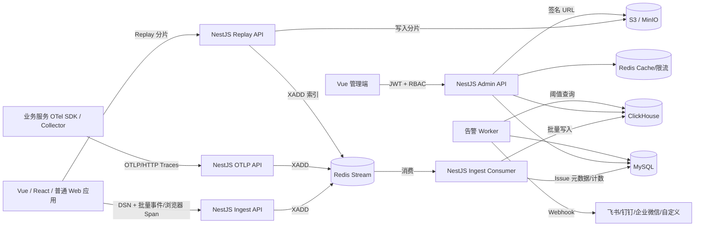
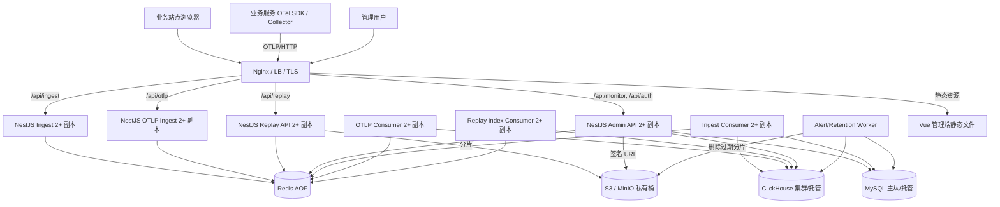

# dt-monitor 系统架构

> 状态：设计方案，尚未实现。  
> 版本：v0.2（2026-11-16）  
> 关联文档：[详细需求](./02-requirements.md)、[执行计划](./04-delivery-plan.md)。

## 1. 架构原则

1. **控制面与数据面分离**：公开上报链路与管理查询链路使用不同入口、不同鉴权和不同限流策略。
2. **SDK 低侵入**：初始化、采集、传输、框架适配全部有异常隔离；失败不影响宿主业务。
3. **协议先行**：事件模型、DSN、字段上限和错误码在 `packages/contracts` 固化，SDK 与后端共同遵守。
4. **按需采集**：性能、错误、埋点均为插件；可单独关闭、采样和过滤。
5. **事实与元数据分离**：ClickHouse 存高基数事件和指标，MySQL 存项目、Issue、告警、埋点定义和权限。
6. **先批后异步**：上报接口只负责鉴权、校验和入队；ClickHouse 写入、Issue 聚合、告警扫描异步执行。
7. **可演进**：Vue/React 适配、Source Map 和更多跨语言接入可增量扩展；Tracing、Replay 作为独立插件包，不污染 core。
8. **遵循 dt-frame 约定**：管理端静态路由与后端菜单同源，使用 `@dt-frames/*` 和统一 HTTP/权限/响应外壳。

## 2. Monorepo 结构

建议新仓库 `dt-monitor` 使用 pnpm workspace；Demo 统一放在 `apps/demo` 下，当前提供 `vue/`、`react/`，后续可继续增加其他 `apps/demo/*` 测试宿主。

```text
dt-monitor/
├─ apps/
│  ├─ web/                 # @dt-monitor/web：Vue 3 管理端
│  ├─ backend/             # @dt-monitor/backend：NestJS API + 消费者
│  └─ demo/                # 测试宿主集合，不并入生产构建
│     ├─ vue/              # @dt-monitor/demo-vue：Vue 3 SDK 测试宿主
│     └─ react/            # @dt-monitor/demo-react：React SDK 测试宿主
├─ packages/
│  ├─ contracts/           # @dt-monitor/contracts：纯 TS 协议、枚举、常量
│  ├─ sdk-core/            # @dt-monitor/sdk-core：框架无关事件管线
│  ├─ sdk-browser/         # @dt-monitor/sdk-browser：浏览器通用 SDK + 默认插件
│  ├─ sdk-tracing/         # @dt-monitor/sdk-tracing：浏览器事务、Span、W3C 传播
│  ├─ sdk-replay/          # @dt-monitor/sdk-replay：采样录音、脱敏、分片上传
│  ├─ sdk-vue/             # @dt-monitor/sdk-vue：Vue 3 适配
│  └─ sdk-react/           # @dt-monitor/sdk-react：React 适配
├─ docker/
│  ├─ docker-compose.dev.yml
│  └─ clickhouse/init.sql
├─ docs/
├─ scripts/
├─ package.json
├─ pnpm-workspace.yaml
├─ turbo.json
└─ tsconfig.base.json
```

`pnpm-workspace.yaml` 必须同时匹配一层和 Demo 下的二层包，避免新增 `apps/demo/*` 时漏装依赖：

```yaml
packages:
  - apps/*
  - apps/demo/*
  - packages/*
```

### 2.1 依赖方向

```text
demo/vue   -> sdk-browser, sdk-tracing, sdk-replay, sdk-vue, contracts
demo/react -> sdk-browser, sdk-tracing, sdk-replay, sdk-react, contracts
web        -> contracts, @dt-frames/*
backend    -> contracts, NestJS/TypeORM/ClickHouse client
sdk-tracing -> sdk-core, contracts
sdk-replay  -> sdk-core, contracts, rrweb 相关运行时
sdk-vue    -> sdk-core, sdk-browser
sdk-react  -> sdk-core, sdk-browser
sdk-browser -> sdk-core, contracts
sdk-core   -> contracts
contracts  -> 无框架依赖
```

禁止：

- `sdk-core` 依赖 Vue、React、Element Plus、NestJS。
- `sdk-vue` / `sdk-react` 复制浏览器采集逻辑。
- `sdk-browser` 强制依赖或默认打包 `sdk-tracing` / `sdk-replay`，导致基础包体积失控。
- `sdk-tracing` / `sdk-replay` 依赖框架包，或在模块加载时执行浏览器采集。
- `packages/*` 引用 `apps/*`。
- 管理端页面直接引用 SDK 源码或后端 `src`。

### 2.2 包职责

| 包 | 职责 | 不做什么 |
| --- | --- | --- |
| `contracts` | 事件类型、DSN 解析类型、字段上限、权限码、API VO、常量 | 不包含运行时 DOM、网络、数据库逻辑 |
| `sdk-core` | 事件模型、插件生命周期、采样、队列、去重、`beforeSend`、传输接口、会话/用户抽象 | 不直接访问 `window`、`document`、`PerformanceObserver` |
| `sdk-browser` | `initMonitor`、浏览器上下文、错误/性能/埋点插件、fetch/sendBeacon、全局监听 | 不绑定 Vue/React |
| `sdk-tracing` | 浏览器事务、Span、fetch/XHR 自动插桩、W3C Trace Context、Trace 独立采样 | 不内置完整 APM，不采集请求/响应体 |
| `sdk-replay` | 会话采样、rrweb 兼容录制、默认遮罩、错误触发缓冲、分片压缩和上传 | 不做截屏、不录制敏感值和未脱敏 DOM |
| `sdk-vue` | Vue 插件、`app.config.errorHandler`、路由 pageview、组件上下文 | 不重新实现错误/传输 |
| `sdk-react` | Provider、Error Boundary、路由/组件上下文 | 不重新实现错误/传输 |

构建建议：

- SDK 包使用 `tsup` 输出 ESM + 类型声明，P1 增加 CJS/IIFE；`sideEffects: false`。
- 框架包将 `vue` / `react` 声明为 peer dependency，不打包进产物。
- `sdk-replay` 的 rrweb 录制运行时与播放器分离；插件入口保持轻量，命中采样后再动态加载重依赖。
- Demo 使用独立 workspace 子项目，根脚本可按名称聚合启动；新增宿主不得改动 SDK 公共 API。
- 管理端和 Demo 使用 Vite；后端使用 NestJS CLI。
- SDK 包增加 `size-limit` 或等价构建体积门禁。

## 3. SDK 架构

### 3.1 公共初始化 API

```ts
import { tracingPlugin } from '@dt-monitor/sdk-tracing'
import { replayPlugin } from '@dt-monitor/sdk-replay'

export interface MonitorOptions {
  dsn: string
  app: { name: string; version?: string }
  environment?: string
  release?: string
  debug?: boolean
  plugins: MonitorPlugin[]
  sampleRate?: number
  beforeSend?: (event: MonitorEvent) => MonitorEvent | null
}

export interface MonitorClient {
  captureException(error: unknown, context?: Record<string, unknown>): string | null
  captureMessage(message: string, level?: Severity, context?: Record<string, unknown>): string | null
  track(eventName: string, properties?: Record<string, Primitive | Primitive[]>): boolean
  identify(distinctId: string, traits?: Record<string, unknown>): void
  setUser(user: MonitorUser | null): void
  setTag(key: string, value: string): void
  setContext(key: string, value: Record<string, unknown>): void
  pageView(payload?: PageViewPayload): void
  flush(): Promise<void>
  disable(): void
}

export function initMonitor(options: MonitorOptions): MonitorClient
```

Demo 接入示例：

```ts
import { initMonitor, errorsPlugin, performancePlugin, analyticsPlugin } from '@dt-monitor/sdk-browser'
import { tracingPlugin } from '@dt-monitor/sdk-tracing'
import { replayPlugin } from '@dt-monitor/sdk-replay'

const monitor = initMonitor({
  dsn: 'https://pk_demo@monitor.example.com/api/ingest/v1/p_1001',
  app: { name: 'demo/vue', version: '1.0.0' },
  environment: 'dev',
  release: 'demo/vue@0.1.0',
  debug: true,
  plugins: [
    errorsPlugin({ captureConsole: true }),
    performancePlugin({ webVitals: true, longTasks: true, sampleRate: 0.1 }),
    analyticsPlugin({ autoPageView: true, sampleRate: 1 }),
    tracingPlugin({ tracesSampleRate: 0.1, maxSpans: 1000 }),
    replayPlugin({ sessionSampleRate: 0.01, errorSampleRate: 1 }),
  ],
})
```

> 用户描述中的 `dns` 在监控领域应为 **DSN（Data Source Name）**，本文统一使用 DSN。

插件配置的默认边界：

- `tracingPlugin`：默认 10% 采样、单 Trace 最多 1,000 Span、最长 30 分钟；默认只向同源请求注入 Trace Context。
- `replayPlugin`：默认 1% 会话采样、错误触发会话 100%；默认遮罩全部输入和敏感元素，命中采样后才动态加载录制依赖。
- 两个插件都可独立关闭；任一插件初始化失败不得阻断错误、性能、埋点插件。

### 3.2 事件管线

```text
插件采集
  -> 标准化为 MonitorEvent
  -> 插件 beforeSend
  -> 全局 beforeSend
  -> 采样/过滤/脱敏
  -> 补充上下文（page/session/user/app/sdk）
  -> 内存队列
  -> 批量封包
  -> fetch / sendBeacon
  -> 成功确认 / 重试 / 丢弃统计
```

设计要求：

- 所有步骤可同步或异步执行，但发送路径不得阻塞页面主线程。
- 队列达到上限时丢弃最旧事件，错误事件可配置更高优先级。
- 事件 ID 由 SDK 生成，服务端以 `event_id` 幂等。
- 每个插件可独立采样；错误默认 100%，性能默认 10%，埋点默认 100%。
- 采样在 `beforeSend` 之后执行，避免被过滤事件消耗采样名额。
- 浏览器 Trace 的 transaction/span 复用普通事件批次和 DSN；服务端 Span 走 OTLP 独立入口，不混入 DSN 批次。
- Replay 的 DOM 分片不走事件队列，由录制插件按独立分片接口上传；错误、Trace 只携带 `sessionId`/`replayId` 关联信息。

### 3.3 插件接口

```ts
export interface MonitorPlugin {
  name: string
  setup?(client: MonitorClient, options: MonitorOptions): void
  start?(): void
  stop?(): void
  beforeSend?(event: MonitorEvent): MonitorEvent | null | Promise<MonitorEvent | null>
  afterSend?(result: SendResult): void
}
```

默认插件：

- `errorsPlugin`：全局异常、Promise、资源错误、console、手动错误。
- `performancePlugin`：Web Vitals、FP、长任务。
- `analyticsPlugin`：页面浏览、自定义事件、用户/会话公共上下文。
- `sessionPlugin`（内部）：会话生成与过期。
- `browserContextPlugin`（内部）：UA、浏览器、OS、设备、页面信息。

框架包只新增：

- Vue：错误处理器、路由 pageview、组件名/tag。
- React：Error Boundary、Provider、可选路由 pageview。

### 3.4 DSN 与传输

建议 DSN 格式：

```text
https://<publicKey>@<host>/api/ingest/v1/<projectId>
```

SDK 解析 DSN 后向以下地址发送：

```text
POST https://<host>/api/ingest/v1/<projectId>?key=<publicKey>
Content-Type: text/plain;charset=UTF-8
```

原因：

- public key 可暴露，管理 API 的 JWT 不可暴露。
- 使用 `text/plain` 和 URL 参数避免自定义 header 触发 CORS 预检。
- 不发送 Cookie，不依赖第三方 Cookie；适合 `sendBeacon`。
- 服务端返回 202，表示已持久化入队，不代表已落 ClickHouse。

传输策略：

- 批量默认 50 条/5s；页面隐藏时立即 flush。
- `fetch` 失败可指数退避重试 3 次；`sendBeacon` 结果不可读时记为 best-effort。
- 5xx/网络错误重试，4xx 丢弃；413 批量拆小重试一次。
- 提供可替换 `Transport` 适配器，便于测试、代理和未来走 OTel。

### 3.5 上下文与会话模型

每个事件公共上下文：

```ts
interface EventContext {
  app: { name: string; version?: string }
  sdk: { name: string; version: string }
  environment?: string
  release?: string
  page?: { id: string; url: string; path: string; title?: string; referrer?: string }
  session?: { id: string; sequence: number }
  trace?: { traceId: string; spanId?: string; sampled: boolean }
  replay?: { replayId: string; recording: boolean; samplingReason?: 'session' | 'error' }
  user?: { id?: string; anonymousId: string; traits?: Record<string, unknown> }
  browser?: { name?: string; version?: string }
  os?: { name?: string; version?: string }
  device?: { type?: 'desktop' | 'mobile' | 'tablet' | 'unknown' }
  tags?: Record<string, string>
  extra?: Record<string, unknown>
}
```

会话规则建议：

- 新会话：无 session、距上次活动 > 30 分钟，或超过 4 小时上限。
- 会话 ID 存 `sessionStorage`，不可用时仅内存。
- `identify` 不必然新建会话；默认保留当前会话并更新用户。
- 页面刷新保留会话；关闭标签页后由过期策略结束。

### 3.6 错误采集

监听优先级和去重：

1. `window.addEventListener('error', handler, true)` 捕获资源错误和普通错误。
2. `window.addEventListener('unhandledrejection', handler)` 捕获未处理 Promise。
3. `console.error` 包装：标记 `mechanism=console`；若 Error 对象与全局监听同一事件，使用错误对象引用/短时指纹去重。
4. Vue/React 错误钩子：标记 `mechanism=vue/react`、`handled=true`，补充组件上下文；全局兜底仍保留。
5. 手动 `captureException`：默认 `handled=true`。

堆栈：

- SDK 优先发送 `error.stack` 字符串；服务端解析为 frames。
- 无法获取 stack 时保留 message、source、lineno、colno。
- 首版不做 Source Map 还原；release 字段先落库，P1 接入。

### 3.7 性能采集

- `web-vitals` 采集 FCP、LCP、CLS、INP、TTFB。
- `PerformanceObserver('paint')` 采集 FP；FP 仅作为诊断指标。
- `PerformanceObserver('longtask')` 采集 `duration > 50ms` 的任务。
- 指标回调时构造事件，可在 pagehide 触发最终 `flush`。
- 每个指标事件带 `page_id`，用于关联页面浏览和错误。
- SPA 首版：页面浏览按路由记录；Web Vitals 以浏览器页面生命周期为主，报告最终 URL/path，并在事件中标记 `navigation_type`；路由级归因 P1。

### 3.8 框架适配

Vue：

```ts
import { createMonitorVuePlugin } from '@dt-monitor/sdk-vue'

app.use(createMonitorVuePlugin({ router, trackPageView: true }))
```

- 安装 `app.config.errorHandler` 前保留原处理器，捕获后调用，避免吞掉宿主行为。
- 组件上下文只采集组件 `name`，不序列化 props/state。
- 路由 pageview 由适配器提供，也可手工 `pageView()`。

React：

```tsx
<MonitorProvider client={monitor}>
  <MonitorErrorBoundary fallback={<ErrorFallback />}>
    <App />
  </MonitorErrorBoundary>
</MonitorProvider>
```

- Error Boundary 捕获 React 渲染错误并上报，再交给宿主 fallback。
- 不覆盖 React 的事件处理错误，交给全局 `error` 监听。
- Provider 只提供 client 和上下文，不重复挂载全局监听。

### 3.9 浏览器分布式 Tracing

浏览器端不引入完整 OpenTelemetry SDK，保持轻量自研 Span 模型；服务端通过标准 OTLP 接入，形成可互操作的分布式链路。

**采集模型**

- 根事务：`pageload`、SPA navigation（`pushState`/`replaceState`/`popstate`）、手动 `custom` transaction。
- 自动 Span：fetch、XMLHttpRequest、资源加载（P1 可扩展）、手动业务 Span。
- `sdk-tracing` 通过 monkey patch 包装 fetch/XHR，在请求前创建客户端 Span，并把当前 Span 写入 W3C header；响应完成后补齐状态码、耗时和错误状态。
- 错误插件和性能插件从当前事务读取 `traceId`/`spanId`，写入事件上下文，供错误、慢请求与 Trace 关联。
- 手动 API 由 `getTracing(client)` 暴露，避免把 Tracing 类型强行塞进框架无关的 `MonitorClient`：

```ts
import { getTracing } from '@dt-monitor/sdk-tracing'

const tracing = getTracing(monitor)
await tracing?.withSpan('checkout.submit', { attributes: { step: 3 } }, async () => {
  await submitOrder()
})
```

**W3C 传播规则**

- `traceId` 为 32 位小写十六进制，Span ID 为 16 位小写十六进制；根事务生成新的 trace，客户端 Span 继承父级。
- 出站请求使用 `traceparent: 00-<traceId>-<spanId>-<sampled>`；`tracestate` 原样保留已知 vendor 段，未知值不得注入。
- 默认只向同源请求注入；跨域目标必须在项目 `allowedTraceOrigins` 白名单中，否则不注入，避免额外 CORS 预检和泄漏。
- 服务端 OpenTelemetry 自动读取 `traceparent` 创建子 Span；未安装 OTel 的服务不会自动产生服务端跨度。
- Trace 采样在根事务创建时决定，子 Span 继承 sampled 标志；未采样 Trace 不上报 Span，但错误、性能、埋点事件仍按各自采样率上报。
- 服务端可接受 W3C 以外的 trace id 格式时先归一化；P0 只保证标准 W3C Context。

**上限和隔离**

- 单 Trace 默认最多 1,000 Span、最长 30 分钟；达到上限后停止新增 Span 并标记 `truncated`。
- fetch/XHR Span 只记录方法、脱敏 URL、状态码、耗时、结果和跨域目标；禁止请求体、响应体、Authorization、Cookie。
- 插件必须恢复原始 fetch/XHR；页面卸载时 flush 未完成 Span，未完成请求以 `cancelled`/`unknown` 结束。
- 浏览器 Span 通过 DSN 与普通事件同批发送，复用校验、限流和 Redis Stream；服务端 Span 通过 OTLP 入口单独入队。

### 3.10 Session Replay

Replay 采用 rrweb 兼容的增量 DOM 快照，不逐帧截图；目标是“可复盘交互与错误现场”，不是录制完整业务数据。

**录制与采样**

- `replayPlugin` 入口保持轻量；会话命中采样后动态加载 rrweb 录制运行时，未命中不下载重依赖。
- 会话采样默认 1%，错误触发采样默认 100%。未命中普通采样但开启错误触发时，SDK 保留默认 60 秒、最大 5MB 的滚动内存缓冲；命中错误后从缓冲建立 Replay 会话并上传，超限即丢弃最旧片段。
- 录制事件包括 DOM 增量、鼠标/键盘交互轮廓、滚动、导航和自定义标记；不录制输入值、请求/响应体、Cookie、localStorage、sessionStorage。
- 默认遮罩全部 `<input>`、`<textarea>`、`<select>`、密码字段和项目配置的敏感选择器；Block 规则元素既不录制内容也不保真展示。
- 默认不录制 Canvas、字体和外链样式；如需开启必须显式配置并重新评估体积、跨域和隐私风险。
- 支持暂停/恢复、用户同意状态和 `disable()`；暂停后停止采集与上传，恢复后开启新片段，不补传暂停期间数据。

**分片与上传**

- 默认每 5 秒或每 256KB（以先到者为准）生成一个分片，单会话最长 30 分钟；超限停止并标记 `truncated`。
- 分片在浏览器侧压缩后上传到独立 Replay 接口；分片按 `sessionId + sequence` 幂等，服务端不把大分片塞入 Redis Stream。
- 每个分片携带 `replayId`、`sessionId`、序号、开始/结束时间、未压缩/压缩大小、校验和和脱敏版本；服务端校验大小、幂等键和 gzip 解压上限后写入对象存储。
- 分片上传失败按有限次数退避重试；对象存储不可用时返回 503 并停止后续录制，不能影响错误/性能/埋点事件上报。

**索引、播放与删除**

- ClickHouse 保存 Replay 会话、分片索引和错误/性能关联数据；S3/MinIO 保存压缩分片，路径按 `projectId/replayId/sequence` 隔离。
- 播放器按需加载，先读取会话/分片索引，再通过带权限校验的短时签名 URL 获取分片；日志记录访问用户、Replay、动作和时间。
- Replay 与错误 Issue、Trace、性能事件通过 `sessionId + pageId + 时间窗`关联，详情页可互相跳转。
- 删除会话时先标记索引为删除中，再清理对象分片，最后写删除审计；失败支持补偿重试。

## 4. 管理端架构

### 4.1 基座

以当前 `jianwei1/apps/web` 为基座：

- Vue 3 + TypeScript + Vite + Pinia + Element Plus + UnoCSS。
- 使用 `@dt-frames/core` 的 HTTP/存储/令牌能力，`@dt-frames/layout` 的登录、菜单和动态路由。
- 使用 `@dt-frames/ui` 的 `useSource`、`useForm`、`useCurd`、`useVxeTable`、`DtVxeTable`。
- 请求统一走 `apps/web/src/utils/http.ts`，不直接使用 axios/fetch。

### 4.2 页面与路由

建议静态路由（最终以真实实现为准）：

| path | name | 权限 | 说明 |
| --- | --- | --- | --- |
| `/monitor/overview` | `monitor-overview` | `monitor:overview:view` | 概览 |
| `/monitor/projects` | `monitor-projects` | `monitor:project:list` | 项目列表 |
| `/monitor/projects/edit` | `monitor-project-edit` | `monitor:project:update` | 新建/编辑（隐藏路由） |
| `/monitor/errors` | `monitor-errors` | `monitor:error:list` | 错误 Issue 列表 |
| `/monitor/errors/detail` | `monitor-error-detail` | `monitor:error:read` | Issue 详情（隐藏路由） |
| `/monitor/performance` | `monitor-performance` | `monitor:performance:view` | 性能总览 |
| `/monitor/performance/detail` | `monitor-performance-detail` | `monitor:performance:view` | 页面性能详情 |
| `/monitor/traces` | `monitor-traces` | `monitor:trace:view` | Trace 列表 |
| `/monitor/traces/detail` | `monitor-trace-detail` | `monitor:trace:read` | Trace 瀑布（隐藏路由） |
| `/monitor/replays` | `monitor-replays` | `monitor:replay:view` | Replay 会话列表 |
| `/monitor/replays/detail` | `monitor-replay-detail` | `monitor:replay:read` | Replay 播放（隐藏路由） |
| `/monitor/analytics` | `monitor-analytics` | `monitor:analytics:view` | 埋点分析 |
| `/monitor/events` | `monitor-events` | `monitor:event:explore` | 事件明细 |
| `/monitor/alerts` | `monitor-alerts` | `monitor:alert:list` | 告警规则/历史 |
| `/monitor/sdk` | `monitor-sdk` | `monitor:settings:view` | SDK 接入说明 |
| `/monitor/settings` | `monitor-settings` | `monitor:settings:view` | 项目设置 |

后端菜单必须提供相同非按钮路径；按钮权限使用 `authCode`。详情页可使用隐藏菜单或列表页内抽屉，最终方案在实现前确认，但必须满足“菜单 path 匹配静态路由”的现有机制。

### 4.3 API 与页面分层

- 页面放 `apps/web/src/views/monitor/<page>/index.vue`。
- 复杂/跨页面接口放 `apps/web/src/api/monitor.ts`；自包含页面可直接 `http`。
- 页面模型与后端 DTO 的映射放 API 或页面 `toView`，不在模板中散落字段转换。
- 图表下拉、过滤器选项等元数据通过接口获取，不在页面维护第三份常量。
- 列表分页使用 `pageKey: 'pageNum'`，响应结构包含 `pageNum/pageSize/total/pages/list`。

### 4.4 图与大数据量

- 图表按需动态加载；优先核查 `@dt-frames/ui` 是否已有图表封装，没有则引入 ECharts。
- 事件明细使用 vxe-table 虚拟滚动或服务端分页；不能一次渲染大量 DOM。
- 趋势图默认返回预聚合数据；不要在浏览器拉取原始事件后聚合。
- Trace 瀑布使用虚拟列表/时间比例布局，限制默认返回 Span 数；Replay 播放器作为独立异步组件，首屏不加载 rrweb/播放器依赖。
- 错误消息、URL 和属性使用文本渲染并转义，避免 `v-html` XSS。
- 大列表使用虚拟滚动；这里的 “virtual” 与 Web Vitals 的 `web-vitals` 是两项独立能力。

## 5. 后端架构

### 5.1 系统上下文



### 5.2 上报数据流

```text
SDK batch
  -> POST /api/ingest/v1/:projectId?key=...
  -> ProjectResolver（key/status/缓存）
  -> Payload/DTO 校验（大小、条数、字段、深度）
  -> Throttler（IP/key/项目）
  -> EnvelopeNormalizer（received_at、来源 IP、Origin）
  -> XADD monitor:ingest
  -> 202 Accepted

Consumer group
  -> XREADGROUP 批量读取
  -> 二次校验 + fingerprint + 脱敏
  -> ClickHouse 批量 INSERT
  -> Issue 计数/首末次异步 upsert
  -> XACK
  -> 失败重试 / 死信 monitor:ingest:dead
```

浏览器 Trace 的 transaction/span 作为事件进入 DSN 批次。服务端 Trace 走独立 OTLP 链路：

```text
服务端 OTel SDK / Collector
  -> POST /api/otlp/v1/traces
  -> server key 校验（x-dt-monitor-key）
  -> Content-Type / 批次大小 / resource/scope/span 字段校验
  -> 归一化为 SpanEnvelope
  -> XADD monitor:otlp:traces
  -> 202 Accepted

OTLP consumer group
  -> trace_id/span_id 去重与项目隔离
  -> monitor_spans 批量 INSERT
  -> Trace 聚合/慢阈值标记
  -> XACK；失败重试或进入 monitor:otlp:traces:dead
```

Replay 分片链路独立于事件队列，避免把 DOM 大对象放入 Redis：

```text
Replay plugin
  -> POST /api/replay/v1/:projectId/:replayId/chunks/:sequence?key=...&sessionId=...
  -> public key + 项目状态 + 分片大小/序号/校验和校验
  -> gzip 解压上限与脱敏版本校验
  -> 写入 S3/MinIO：replay/{projectId}/{replayId}/{sequence}.gz
  -> XADD monitor:replay:index
  -> 204 No Content（对象与索引消息均已持久化）

Replay index consumer
  -> 更新 ClickHouse 会话/分片索引
  -> 完成会话状态、容量统计和失败标记
  -> 对象写入成功但索引失败时进入补偿扫描
```

要求：

- 202 只能发生在 `XADD` 成功后；Redis 不可用返回 503。
- Consumer 只有 ClickHouse 写入成功后才 ACK；失败按 pending 重试，超过次数进死信。
- ClickHouse 批量建议 500–5,000 条或 1 秒窗口；`async_insert` 仅作为优化，不能牺牲错误可观测性。
- `event_id` 去重：ClickHouse 查询使用 `uniqExact(event_id)`；`ReplacingMergeTree` 做最终收敛，不依赖实时去重。
- 服务端时间统一 UTC；响应/界面按 `Asia/Shanghai` 展示。
- OTLP 成熟服务端 Span 与浏览器 Span 使用相同 `traceId`；跨服务父 Span ID 必须保留，服务端缺少 `traceparent` 时以自身 Span 为根。
- Replay 分片先落对象存储再入索引队列；只有两者都成功才返回 204，索引可查询仍可能有短暂异步延迟。

### 5.3 NestJS 模块

| 模块 | 职责 |
| --- | --- |
| `AuthModule` / `UsersModule` / `RolesModule` / `MenusModule` | 复用 dt-frame 登录、JWT、RBAC、菜单、用户 |
| `ProjectsModule` | 项目、DSN、key 轮换、成员、配置 |
| `IngestModule` | 公开上报、payload 校验、限流、入队 |
| `IngestConsumerModule` | Redis Stream 消费、标准化、ClickHouse 写入、死信 |
| `OtlpModule` | OTLP/HTTP JSON 接入、server key、Trace 字段归一化、入队 |
| `OtlpConsumerModule` | 服务端 Span 消费、Trace 聚合、ClickHouse 写入 |
| `TracingModule` | Trace 列表/详情/瀑布查询、慢阈值与错误关联 |
| `ReplayModule` | Replay 元数据、分片上传、索引、播放授权、删除 |
| `ReplayIndexConsumerModule` | Replay 索引消费、会话状态、容量与失败补偿 |
| `ObjectStorageModule` | S3/MinIO 客户端、私有桶、分片读写、签名 URL、清理 |
| `EventStoreModule` | ClickHouse client、批量插入、查询封装 |
| `ErrorTrackingModule` | 错误查询、Issue 聚合、状态更新 |
| `PerformanceModule` | Web Vitals、长任务、页面趋势 |
| `AnalyticsModule` | 埋点事件、事件定义、未登记检测 |
| `OverviewModule` | 概览卡片和跨模块趋势 |
| `AlertsModule` | 规则 CRUD、定时扫描、Webhook、历史 |
| `RetentionModule` | TTL 配置校验、手动清理、清理审计 |
| `ExportModule` | P1 导出任务与权限 |
| `HealthModule` | 健康检查、队列/ClickHouse/MySQL 状态 |

通用基础设施：

- 全局前缀 `/api`、统一响应 `{ code, data, message }`、统一异常 `{ code, message, timestamp, path }`。
- 全局 JWT 守卫；公开事件上报、Replay 分片、OTLP 接入和健康接口使用 `@Public()`，并分别执行 key 校验。
- `ValidationPipe({ whitelist: true, transform: true })`。
- Swagger 文档 `/api/docs`。
- TypeORM `synchronize: false`，所有表结构通过 migration。
- 所有管理接口使用 `@RequirePermission`；项目级数据在 service 层二次校验成员关系。
- 日志结构化；禁止打印完整事件、DSN、JWT、数据库口令。

### 5.4 存储分工

| 存储 | 角色 | 不存什么 |
| --- | --- | --- |
| MySQL | 控制面：项目、key、成员、Issue 元数据、埋点定义、告警规则、权限 | 不存海量原始事件/时间序列 |
| ClickHouse | 数据面：原始事件、错误/性能/埋点明细、小时聚合、长任务 | 不存可频繁更新的业务状态 |
| Redis | 持久队列、限流、项目配置缓存、Issue 计数、告警状态 | 不作为唯一事实存储 |
| 对象存储 | P0 Replay 压缩分片、P1 Source Map、导出文件、备份 | 不存明文请求体、未脱敏 DOM 或可公开直链 |

### 5.5 MySQL 控制面模型

所有业务实体继承审计基类（`create_user/create_time/update_user/update_time/deleted`），查询统一过滤 `deleted = 0`。

| 表 | 关键字段 | 说明 |
| --- | --- | --- |
| `monitor_project` | id, code, name, platform, status, default_environment, retention_days, aggregate_retention_days, sample_rates_json, allowed_origins, config_json, archived_at | 项目主表 |
| `monitor_project_key` | id, project_id, kind(browser/server), public_key, server_key_hash, key_prefix, status, last_used_at, created_at, revoked_at | 浏览器 public key 可轮换；server key 仅创建时返回明文，持久化哈希 |
| `monitor_project_member` | project_id, user_id, role, unique(project_id,user_id) | 项目级权限 |
| `monitor_issue` | id, project_id, fingerprint, title, error_type, severity, status, first_seen, last_seen, event_count, affected_users, assignee_user_id, sample_event_id | Issue 聚合与分诊 |
| `monitor_tracker_event` | id, project_id, event_name, display_name, description, status, owner_user_id, strict_mode | 埋点事件定义 |
| `monitor_tracker_property` | id, event_definition_id, name, data_type, required, description, enum_values_json, status | 事件属性定义 |
| `monitor_alert_rule` | id, project_id, name, rule_type, filter_json, threshold, window_minutes, consecutive, cooldown_minutes, channels_json, status, last_triggered_at | 告警规则 |
| `monitor_alert_history` | id, rule_id, project_id, status, metric_value, payload_json, channel_result, triggered_at | 告警历史 |
| `monitor_release` | id, project_id, version, commit_sha, deployed_at, metadata_json | P1，版本关联 |
| `monitor_source_map` | id, project_id, release, file_name, storage_key, size, status | P1，私有存储 |
| `monitor_replay_access_log` | id, project_id, replay_id, user_id, action, ip, user_agent, created_at | Replay 播放/访问审计 |
| `monitor_replay_delete_log` | id, project_id, replay_id, operator_id, scope, status, reason, created_at, completed_at | Replay 删除审计与补偿 |
| `monitor_replay_share` | id, project_id, replay_id, token_hash, expires_at, created_by, status | P1，短时分享链接 |
| `monitor_saved_query` | id, project_id, module(trace), owner_user_id, name, filter_json, status | P0 Trace 保存查询；后续可复用到其他模块 |

建议 Issue 的唯一约束：`UNIQUE(project_id, fingerprint)`。状态至少支持 `open / resolved / ignored`；回归检测在状态为 `resolved` 时新事件命中触发。

### 5.6 ClickHouse 数据模型

主表 `monitor_events` 保存错误、性能、埋点和页面事件。浏览器 transaction/span 由 Ingest Consumer 归一化后写入 `monitor_spans`，与服务端 Span 共用同一数据模型，保证 Trace 瀑布可按 `traceId` 查询。

`monitor_events`（示意）：

| 列 | 类型 | 说明 |
| --- | --- | --- |
| `project_id` | UInt64 | 项目隔离与分区过滤 |
| `event_id` | String | 客户端 UUID，去重键 |
| `event_type` | LowCardinality(String) | error/performance/track/page_view/identify/session |
| `timestamp` | DateTime64(3, 'UTC') | 客户端事件时间 |
| `received_at` | DateTime64(3, 'UTC') | 服务端接收时间，查询基准 |
| `environment` / `release` | LowCardinality(String) | 环境和版本 |
| `sdk_name` / `sdk_version` | LowCardinality(String) | SDK 信息 |
| `session_id` / `distinct_id` / `anonymous_id` | String | 会话和用户 |
| `page_id` / `page_url` / `page_path` | String | 页面上下文 |
| `browser` / `browser_version` / `os` / `device_type` | LowCardinality(String) | 设备上下文 |
| `fingerprint` | String | 错误分组 |
| `error_type` / `error_message` / `error_stack` | String | 错误明细 |
| `metric_name` / `metric_value` / `metric_rating` | LowCardinality(String) / Float64 / LowCardinality(String) | Web Vitals |
| `duration_ms` | Float64 | 长任务或耗时 |
| `event_name` | String | 埋点名 |
| `properties_json` | String | 事件属性 JSON，查询时用 JSONExtract |
| `context_json` | String | 扩展上下文 |
| `tags` | Map(String, String) | 公共标签 |

表引擎与生命周期建议：

```sql
ENGINE = ReplacingMergeTree(received_at)
PARTITION BY toYYYYMM(received_at)
ORDER BY (project_id, event_type, toDate(received_at), event_id)
TTL received_at + INTERVAL 90 DAY DELETE
```

- 原始表默认 TTL 90 天，项目只允许配置到系统上限。

Trace 主表 `monitor_spans`（示意）：

| 列 | 类型 | 说明 |
| --- | --- | --- |
| `project_id` | UInt64 | 项目隔离 |
| `trace_id` | FixedString(32) | W3C Trace ID |
| `span_id` | FixedString(16) | Span ID |
| `parent_span_id` | FixedString(16) | 父 Span，空值表示根 Span |
| `source` | LowCardinality(String) | browser/server |
| `service_name` / `service_version` | LowCardinality(String) | 服务或前端应用标识 |
| `operation` | String | 事务或 Span 名称 |
| `span_type` | LowCardinality(String) | transaction/fetch/xhr/db/http/custom 等 |
| `start_time` | DateTime64(3, 'UTC') | 开始时间 |
| `duration_ms` | Float64 | 耗时 |
| `status` | LowCardinality(String) | ok/error/cancelled/unknown |
| `status_message` | String | 受控错误摘要 |
| `environment` / `release` | LowCardinality(String) | 环境和版本 |
| `session_id` / `page_id` / `page_path` | String | 关联上下文 |
| `http_method` / `http_url` / `http_status` | LowCardinality(String) / String / UInt16 | 网络 Span 摘要，URL 必须脱敏 |
| `attributes_json` | String | 受控属性和 OTLP attributes |
| `received_at` | DateTime64(3, 'UTC') | 服务端接收时间 |
| `truncated` | UInt8 | 是否因上限截断 |

```sql
ENGINE = ReplacingMergeTree(received_at)
PARTITION BY toYYYYMM(start_time)
ORDER BY (project_id, toDate(start_time), trace_id, start_time, span_id)
TTL start_time + INTERVAL 90 DAY DELETE
```

Replay 只把元数据和分片索引写 ClickHouse，DOM 分片写对象存储。建议表：

| 表 | 关键字段 | 说明 |
| --- | --- | --- |
| `monitor_replay_sessions` | project_id, replay_id, session_id, started_at, ended_at, duration_ms, environment, release, page_path, distinct_id, sampling_reason, status, error_count, chunk_count, compressed_bytes, consent_version, updated_at | Replay 会话索引；`ReplacingMergeTree(updated_at)` 收敛更新 |
| `monitor_replay_chunks` | project_id, replay_id, sequence, captured_from, captured_to, storage_key, compressed_bytes, uncompressed_bytes, checksum, status, received_at | 分片索引；对象键不直接暴露给前端 |
| `monitor_replay_daily` | project_id, date, environment, release, sessions, errors, bytes | Replay 容量/质量聚合 |

Replay 会话和分片索引默认 TTL 30 天。删除流程必须同时更新索引状态、删除对象存储分片并写审计，不能只删一侧。
Replay 日聚合表默认保留 365 天，仅保存会话数、错误数和字节等统计，不包含 DOM。

- 为错误、性能、埋点建立物化视图/投影，避免所有看板扫全量宽表。
- 小时聚合表建议使用 `AggregatingMergeTree`：
  - `monitor_web_vitals_hourly`：`quantilesState(0.5, 0.75, 0.95)`、count、sum。
  - `monitor_long_tasks_hourly`：count、sum(duration)、quantilesState。
  - `monitor_analytics_hourly`：count、uniqState(distinct_id)、uniqState(session_id)。
  - `monitor_issue_hourly`：按 project/fingerprint/environment/release 聚合 count、uniq users。
  - `monitor_trace_hourly`：按 project/service/operation/environment/release 聚合 count、错误数、`quantilesState(0.5, 0.75, 0.95, 0.99)`。
  - `monitor_replay_daily`：按 project/environment/release 聚合会话数、错误会话数、分片字节。
- 聚合表 TTL 建议 365 天；超出留存的数据由离线归档或删除任务处理。
- `event_id` 去重通过查询 `uniqExact(event_id)` 保证统计准确；`ReplacingMergeTree` 只用于最终收敛。
- 查询必须带 `project_id` 和时间范围；禁止无界全表扫描。

### 5.7 Redis 键设计

| key/stream | 类型 | 用途 |
| --- | --- | --- |
| `monitor:ingest` | Stream | 待消费事件批次，consumer group `monitor-consumers` |
| `monitor:ingest:dead` | Stream | 超过重试次数的事件批次 |
| `monitor:otlp:traces` | Stream | 服务端 Span 批次，consumer group `monitor-otlp-consumers` |
| `monitor:otlp:traces:dead` | Stream | OTLP 字段/映射失败或超过重试的批次 |
| `monitor:replay:index` | Stream | Replay 分片对象写入成功后的索引消息 |
| `monitor:replay:index:dead` | Stream | Replay 索引失败/补偿消息 |
| `monitor:project:{id}` | String/JSON | 项目配置、key 状态缓存，TTL 60s |
| `monitor:rate:{scope}:{id}` | String/计数 | 限流窗口 |
| `monitor:issue:count:{project}:{fingerprint}` | Hash | 消费者增量计数，定时刷 MySQL |
| `monitor:alert:state:{rule}` | Hash | 连续次数、冷却、最近状态 |
| `monitor:replay:upload:{project}:{replay}` | String/计数 | Replay 分片速率、序号连续性和容量保护 |
| `monitor:session` | 不存 | 会话由 SDK 生成，服务端不维护在线会话状态 |

Redis 配置：

- 队列与缓存建议分库或分实例。
- 队列 Redis 使用 AOF `everysec`（或更强），`maxmemory-policy noeviction`。
- Replay 分片正文不进入 Redis；对象存储写入成功后只入队索引消息。
- 死信保留时间需可配置并监控。

### 5.8 Issue 聚合与分诊

聚合输入为标准化错误事件：

1. 归一化错误消息：去除动态 ID、数字、UUID、时间戳、URL query、堆栈中的机器路径等易变部分。
2. 取顶层业务栈帧：优先 `inApp` 帧，过滤 SDK/框架内部帧；资源错误使用资源 URL。
3. 计算 fingerprint：`type | normalizedMessage | topFrame.function | topFrame.file:line`。
4. 允许 SDK 显式 `fingerprint` 覆盖；后端仍记录原始值。
5. 消费者把 `project_id + fingerprint` 增量写入 Redis Hash；Flusher 每 10s 批量 upsert `monitor_issue`，更新 `first_seen/last_seen/event_count`。
6. 新 Issue 或已解决 Issue 再次命中时标记回归；告警 Worker 读取 Redis 状态并触发。

一致性策略：

- `monitor_issue` 用于快速列表、状态和责任人；计数允许最多约 60s 延迟。
- Issue 详情趋势和精确影响用户数从 ClickHouse 查询；MySQL 不承担复杂时间序列。
- 同一 fingerprint 在不同 environment/release 下不拆分 Issue，作为维度展示；如果用户需要拆分，可在 P1 支持分组规则。
- 合并/拆分 Issue、责任人、备注、忽略规则为 P1；P0 先支持状态、指派和样本。

### 5.9 查询与聚合策略

- 所有 ClickHouse 查询必须带 `project_id`、`from`、`to`；后端强制最大时间范围。
- 7 天以内常规趋势可查原始表；30 天以上优先查小时聚合表。
- 分位数使用 `quantile(0.5/0.75/0.95)` 或 `quantilesState`；不要用平均值代替性能分位数。
- 分页查询先过滤时间/项目/类型/维度，再排序；禁止跨全表 `ORDER BY`。
- 单次查询设置 `max_execution_time`、`max_result_rows`、内存限制；超时返回明确错误。
- 维度值来自白名单：metric、event type、状态、浏览器、OS、设备类型；自由文本只进入受控参数。
- 查询 SQL 不拼接用户输入；使用 ClickHouse client 参数化或严格转义。
- 前端筛选条件以 URL/query 参数传递，从后端生成聚合，不在浏览器加载原始明细后聚合。

### 5.10 告警执行

告警 Worker 通过 `@nestjs/schedule` 每分钟执行：

1. 读取启用的规则和冷却状态。
2. 按规则类型查询 ClickHouse 聚合（错误数量、新/回归 Issue、指标 p75/p95、长任务数量）。
3. 检查窗口、连续次数、阈值。
4. 满足时写入 `monitor_alert_history`，更新 Redis 状态，发送 Webhook/邮件。
5. 恢复条件满足时发送恢复通知；冷却期内只记录不重复发送。

Webhook 载荷按以下结构实现：

| 字段 | 内容 |
| --- | --- |
| project | 项目 id 和名称 |
| rule | 规则 id、名称、窗口 |
| status | triggered / recovered |
| metric | 指标名、值、单位、窗口 |
| filters | environment、release、pagePath 等 |
| triggeredAt | ISO UTC 时间 |
| link | 管理端定位链接 |

Webhook 需签名/重试/超时/响应码记录；失败可在 P1 增加队列重试，P0 至少写入告警历史并标记失败。

### 5.11 留存、清理与备份

- ClickHouse 表设系统最大 TTL（例如原始 365 天），项目配置只能低于该上限。
- 为了支持项目级留存，查询层按项目 `retention_days` 限制可查询时间；后台清理任务按月/项目分批删除超期分区或执行轻量 mutation，界面提示清理是异步的。
- 如果目标 ClickHouse 版本已验证支持按列动态 TTL，可改为行级 TTL；实施前必须做版本验证，不能凭假设写生产 SQL。
- 聚合表保留 365 天，原始明细默认 90 天；修改留存只影响后续数据，并提供生效时间提示。
- Span 默认 90 天、Replay 索引与对象分片默认 30 天；项目可配置更低值。Replay 清理必须同时删除索引和对象，失败进入补偿队列。
- 手动清理必须二次确认、记录操作人、范围和时间；执行前检查磁盘和查询负载。
- 备份：MySQL 每日全量 + binlog；ClickHouse 快照/备份到对象存储；Redis 只备份队列必要状态和配置缓存，不作为事实源。

## 6. API 契约

### 6.1 通用规则

- 管理端基址 `/api`（`apps/web/src/utils/http.ts` 已设置）。
- 成功：`{ code: 0, data, message: 'ok' }`。
- 失败：`{ code, message, timestamp, path }`。
- 分页字段：`pageNum`、`pageSize`、`total`、`pages`、`list`；`pageSize` 最大 100。
- 时间参数使用 ISO 8601 UTC 字符串 `from` / `to`；前端按 `Asia/Shanghai` 展示。
- 管理 API 默认 JWT；公开事件上报、Replay 分片和 OTLP 接入用 `@Public()`，但必须分别校验 public key / server key。
- 所有管理查询参数都带 `projectId`，服务端校验项目成员。
- 事件明细使用服务端分页或虚拟滚动，禁止无限大分页。

### 6.2 公开上报

| 方法 | 路径 | 说明 | 鉴权 |
| --- | --- | --- | --- |
| POST | `/ingest/v1/:projectId?key=...` | 批量事件上报 | DSN public key |
| GET | `/ingest/v1/:projectId/config?key=...` | P1 远程采集配置 | DSN public key |
| POST | `/otlp/v1/traces` | OTLP/HTTP JSON Traces 接入 | 独立 server key（`x-dt-monitor-key`） |
| POST | `/replay/v1/:projectId/:replayId/chunks/:sequence?key=...&sessionId=...&checksum=...` | gzip Replay 分片上传 | DSN public key |
| GET | `/health` | 服务健康检查 | 可选公开 |

上报信封包含：

- `sdk`：name、version。
- `sentAt`：ISO UTC。
- `events`：`MonitorEvent[]`。

上报响应：

- 成功：HTTP 202，返回 accepted/rejected 数量。
- 整批非法：4xx。
- 部分事件非法：仍返回 202，严格列出 rejected 数量，合法事件照常入队。
- 项目禁用/队列不可用：4xx/503，不能伪成功。

OTLP 接入要求：

- 请求头 `x-dt-monitor-key` 只允许服务端持有；浏览器 public key 一律拒绝。
- P0 支持 OTLP/HTTP JSON，Content-Type 仅允许 `application/json`；Protobuf/gRPC 放 P1。
- 成功返回 202 和 accepted/rejected Span 数；部分非法 Span 不得静默丢弃，必须返回拒绝计数并记录原因。
- trace/span ID、parent ID、时间、状态和 resource/scope 映射失败时拒绝该 Span，不影响同批其他合法 Span。
- 批次、Span 数、属性深度和字符串长度受限；超限返回 413/422，不能写入截断后的伪完整 Span。

Replay 分片接入要求：

- 请求体上限默认 256KB，压缩格式为 gzip；服务端限制解压后大小，防压缩炸弹。
- Replay 接口允许受控 CORS 预检，只接受 `application/octet-stream`，不携带认证 Cookie；Origin 不在项目白名单时拒绝。
- `sequence` 在同一 `replayId` 内单调递增且幂等；重复上传返回成功而不覆盖不同校验和的内容。
- 对象写入且索引消息成功入队后返回 204；对象存储或 Redis 不可用返回 503，SDK 停止后续录制并有限重试；已写对象保留用于幂等重试和补偿扫描。
- 分片接口与事件上报分别限流；分片失败不能推进普通事件队列失败。

### 6.3 项目管理

| 方法 | 路径 | 权限 |
| --- | --- | --- |
| GET | `/monitor/projects` | `monitor:project:list` |
| POST | `/monitor/projects` | `monitor:project:create` |
| GET | `/monitor/projects/:id` | `monitor:project:list` |
| PATCH | `/monitor/projects/:id` | `monitor:project:update` |
| POST | `/monitor/projects/:id/archive` | `monitor:project:update` |
| GET | `/monitor/projects/:id/keys` | `monitor:project:list` |
| POST | `/monitor/projects/:id/keys` | `monitor:project:rotate-key`（body 指定 browser/server） |
| POST | `/monitor/projects/:id/keys/:keyId/revoke` | `monitor:project:rotate-key` |
| GET | `/monitor/projects/:id/dsn` | `monitor:project:list` |
| GET/POST/PATCH/DELETE | `/monitor/projects/:id/members` | `monitor:project:member` |

### 6.4 概览、错误、性能、Trace、Replay、埋点

| 方法 | 路径 | 权限 |
| --- | --- | --- |
| GET | `/monitor/overview/summary` | `monitor:overview:view` |
| GET | `/monitor/errors/trend` | `monitor:error:list` |
| GET | `/monitor/errors/issues` | `monitor:error:list` |
| GET | `/monitor/errors/issues/:id` | `monitor:error:read` |
| PATCH | `/monitor/errors/issues/:id` | `monitor:error:update` |
| GET | `/monitor/errors/events` | `monitor:error:read` |
| GET | `/monitor/performance/summary` | `monitor:performance:view` |
| GET | `/monitor/performance/timeseries` | `monitor:performance:view` |
| GET | `/monitor/performance/pages` | `monitor:performance:view` |
| GET | `/monitor/performance/long-tasks` | `monitor:performance:view` |
| GET | `/monitor/traces` | `monitor:trace:view` |
| GET/POST/PATCH/DELETE | `/monitor/traces/saved-views` | `monitor:trace:view` |
| GET | `/monitor/traces/:traceId` | `monitor:trace:read` |
| GET | `/monitor/traces/:traceId/spans` | `monitor:trace:read` |
| GET | `/monitor/replays` | `monitor:replay:view` |
| GET | `/monitor/replays/:replayId` | `monitor:replay:read` |
| GET | `/monitor/replays/:replayId/playback` | `monitor:replay:read` |
| DELETE | `/monitor/replays/:replayId` | `monitor:replay:delete` |
| GET | `/monitor/analytics/summary` | `monitor:analytics:view` |
| GET | `/monitor/analytics/events` | `monitor:analytics:view` |
| GET/POST/PATCH/DELETE | `/monitor/analytics/event-definitions` | `monitor:analytics:event-def` |
| GET | `/monitor/events/explore` | `monitor:event:explore` |

### 6.5 告警与设置

| 方法 | 路径 | 权限 |
| --- | --- | --- |
| GET/POST/PATCH/DELETE | `/monitor/alerts/rules` | `monitor:alert:list/create/update/delete` |
| POST | `/monitor/alerts/rules/:id/test` | `monitor:alert:update` |
| GET | `/monitor/alerts/history` | `monitor:alert:list` |
| GET/PATCH | `/monitor/settings/:projectId` | `monitor:settings:view/update` |
| GET | `/monitor/settings/:projectId/sdk-snippet` | `monitor:settings:view` |
| POST | `/monitor/settings/:projectId/purge` | `monitor:settings:update` |

### 6.6 关键查询参数

- `projectId`、`from`、`to`、`environment`、`release`、`pagePath`、`browser`、`os`、`deviceType`、`status`、`metric`、`eventName`、`traceId`、`serviceName`、`operation`、`spanStatus`、`minDurationMs`、`replayId`、`samplingReason`、`pageNum`、`pageSize`。
- `metric` 仅允许 `FP/FCP/LCP/CLS/INP/TTFB`。
- Trace 列表默认只返回根事务；Span 详情必须按 `traceId` 查询并限制最大返回数量。
- Replay 播放接口返回短期签名 URL 或受控代理地址，不返回对象存储凭证；每次授权写访问审计。
- 自由文本搜索限制长度；筛选属性只能使用已登记或白名单字段，不允许任意 ClickHouse 表达式。
- 所有响应使用明确 VO；不直接返回 TypeORM entity、数据库错误或堆栈。

## 7. 部署拓扑

### 7.1 本地开发

Docker Compose 提供：

| 服务 | 端口 | 用途 |
| --- | --- | --- |
| mysql | 3306 | 控制面、Issue、菜单权限、告警 |
| redis | 6379 | 队列、限流、缓存 |
| clickhouse | 8123 / 9000 | 事件明细和聚合 |
| minio | 9002 / 9003 | Replay 分片与 P1 Source Map 私有对象存储 |
| backend | 3001 | NestJS API、消费者、告警 Worker |
| web | 5173 | Vue 管理端 |
| demo/vue | 5174 | Vue SDK 测试 |
| demo/react | 5175 | React SDK 测试 |

建议目录：

```text
docker/
  docker-compose.dev.yml
  clickhouse/init.sql
  mysql/init/01-schema.sql
  minio/init-bucket.sh
  .env.example
```

要求：

- `.env.example` 只放占位值；真实密码、JWT 私钥、SMTP、Webhook secret 不进仓库。
- ClickHouse 数据/日志和 MySQL 数据使用 named volume。
- MinIO 使用 named volume；启动时创建私有 `replay` 桶和最小权限访问账号，不开放匿名读写。
- 后端启动时等待依赖健康检查；migration 不随应用自动执行，使用独立命令。
- Demo 通过环境变量接收 DSN、服务端 OTLP 测试地址和 server key，不把生产 key 写死在源码。

### 7.2 生产拓扑



建议：

- 上报域名可独立为 `monitor-ingest.example.com`，减少与业务域名/广告拦截规则的耦合。
- Admin API 与 Ingest API 可同进程部署，但生产按流量和权限独立扩容；Ingest 不暴露 Swagger。
- Redis 队列使用持久化、监控积压和内存；队列与缓存分开。
- ClickHouse 单节点可作为初期部署，必须监控磁盘、副本、慢查询和 merge 延迟；增长后升级集群/托管。
- 对象存储必须使用私有桶、TLS 和最小权限账号；生产优先使用托管 S3，MinIO 仅作为本地/私有化选项。
- MySQL 备份与 migration 独立管理；禁止生产 `DB_SYNCHRONIZE=true`。
- 全链路 TLS；管理端限制来源 IP/SSO（可选）；上报接口保持公开。

## 8. 安全与故障处理

### 8.1 安全边界

- Ingest：public key + 项目状态 + CORS + 限流 + payload 上限 + 结构校验；不能读数据。
- OTLP：独立 server key + 项目状态 + 限流 + 批次/字段校验；key 只在服务端使用，拒绝浏览器来源的误用风险。
- Replay upload：public key + 分片序号 + 大小/压缩比/校验和校验；分片与项目、Replay 会话绑定，禁止跨项目写入。
- Admin：JWT + RBAC + 项目成员校验；只走管理域名/路由。
- ClickHouse/MySQL/Redis 不暴露公网端口，只允许后端网络访问。
- Webhook 出站仅允许 HTTPS，设置超时和最大响应体；可选目标域名白名单。
- 管理端按 `projectId` 过滤，服务层再次校验；禁止仅依赖前端隐藏。
- 错误消息和属性渲染转义；下载文件名编码；SSRF/CSV 注入防护。
- Replay 播放必须在无管理端同源权限的隔离容器/iframe 中渲染；过滤脚本、外链和危险 URL scheme，播放器不得继承管理端 Cookie/localStorage。
- 对象存储桶默认私有；分片 key 不返回给前端；签名 URL 短时有效并绑定目标对象，禁止桶级列举。
- 敏感配置只从环境变量/Secret 管理系统读取；不写 `.env`。

### 8.2 故障降级

| 故障 | 行为 |
| --- | --- |
| Redis 队列不可用 | 上报返回 503，SDK 重试；不能返回 202 |
| ClickHouse 不可用 | 消费者暂停 ACK，事件留在 Pending/Stream；上报仍可入队；积压告警 |
| MySQL 不可用 | 管理接口失败；上报 key 读取可依赖短缓存，但缓存失效后拒绝；Issue 元数据更新延迟 |
| 消费者崩溃 | pending 消息由 consumer group 重新领取；超过重试进死信 |
| OTLP 队列不可用 | 返回 503，服务端 OTel exporter 重试；不得返回伪 202 |
| OTLP 部分字段非法 | 拒绝该 Span 并返回计数，合法 Span 继续入队；死信保留原始错误摘要 |
| 对象存储不可用 | Replay 分片返回 503，SDK 停止录制并有限重试；错误/性能/埋点上报不受影响 |
| Replay 索引写入失败 | 分片对象保留，索引消息重试/进入补偿扫描；会话标记 incomplete，不伪造可播放 |
| 告警通道失败 | 告警历史记录失败，不阻塞其他规则；重试放 P1 |
| SDK 采集异常 | 内部 try/catch 吞掉并 debug 记录；不影响宿主 |

### 8.3 自监控

- Ingest：QPS、202/4xx/503、p95 延迟、限流次数、批次大小。
- Queue：长度、pending、死信、消费延迟。
- Consumer：插入成功/失败、批次耗时、ClickHouse 错误。
- OTLP：202/4xx/503、Span 接受/拒绝数、字段映射失败、队列延迟。
- Replay：分片上传成功率、压缩比、解压失败、对象存储延迟、索引积压、孤儿分片、删除失败。
- API：慢查询、错误率、分页上限触发。
- 数据：每个项目日事件量、Span 数、Replay 会话/字节数、丢弃/拒绝比例、SDK 版本分布。
- 告警：规则执行耗时、失败率、通道成功率。

## 9. 架构决策记录（ADR）

### ADR-001：使用 pnpm Monorepo

- **决策**：SDK、管理端、后端、Demo 放同一仓库，包管理器使用 pnpm。
- **原因**：协议、权限码和示例代码同步演进；SDK 与 Demo 可本地联调；避免多仓版本漂移。
- **代价**：CI 需要按包过滤，构建链路更长；通过 turbo/pnpm filter 控制。

### ADR-002：事件明细使用 ClickHouse

- **决策**：事件、Web Vitals、长任务、埋点明细和小时聚合放 ClickHouse；MySQL 只存控制面。
- **原因**：高写入、宽表、时间范围聚合、列式压缩和 TTL 更适合 ClickHouse。
- **代价**：运维复杂；P0 先单节点，生产提供集群/托管选项。

### ADR-003：控制面使用 MySQL + TypeORM

- **决策**：复用 dt-frame 的 MySQL/TypeORM/JWT/RBAC/migration 约定。
- **原因**：与现有后台一致；Issue 状态、告警、项目配置适合事务更新。
- **代价**：Issue 列表与 ClickHouse 统计存在最终一致性；需异步计数和明确延迟。

### ADR-004：P0 使用 Redis Streams

- **决策**：上报先写 Redis Stream，consumer group 消费；失败进死信。
- **原因**：部署简单、可持久化、天然支持 ACK/重试；初期吞吐足够。
- **替代**：BullMQ、Kafka、NATS；当吞吐/多租户/跨地域成为瓶颈时再评估。
- **代价**：需要自行实现死信、监控、retry；Redis 必须持久化和容量规划。

### ADR-005：DSN 使用公开项目 key

- **决策**：浏览器只持有项目 public key，不持有管理 JWT。
- **原因**：前端密钥必然可被查看；公开 key 只授予写入能力，可轮换。
- **代价**：存在垃圾上报风险；必须限流、项目状态、Origin 记录和用量告警。

### ADR-006：SDK 分层为 core / browser / framework

- **决策**：`sdk-core` 不访问 DOM；`sdk-browser` 提供浏览器插件；Vue/React 只做适配。
- **原因**：可测试、可扩展、框架包体积小、避免重复监听。
- **代价**：包数量增加；通过明确依赖和导出减少使用复杂度。

### ADR-007：Web Vitals 使用 web-vitals + FP 补充

- **决策**：标准指标用 `web-vitals`；FP 用 Paint Timing；长任务用 PerformanceObserver。
- **原因**：与 Chrome/Google 度量口径一致，体积小，支持 buffered。
- **代价**：浏览器差异和 SPA 归因限制；需要明确文档和降级策略。

### ADR-008：浏览器轻量 Span + 服务端 OTLP 的分布式 Tracing

- **决策**：浏览器端自研轻量 Span 和 W3C Trace Context，复用 DSN 上报；服务端通过 OTLP/HTTP 接入；浏览器与服务端 Span 汇聚到同一 ClickHouse 表。
- **原因**：完整 OpenTelemetry Web SDK 体积和接入复杂度过高；W3C + OTLP 能保留跨语言、跨服务互操作能力。
- **代价**：浏览器自动插桩范围有限，需维护 fetch/XHR hook 和上下文传播测试；P0 只支持 OTLP JSON，不支持全部 OTLP 传输协议。

### ADR-009：Session Replay 使用采样 + 脱敏 + 对象存储

- **决策**：采用 rrweb 兼容增量 DOM 录制，默认低采样、错误触发采样、输入全遮罩；DOM 分片压缩写对象存储，ClickHouse 只存索引。
- **原因**：Replay 数据体积大、隐私风险高，不能进入事件表或 Redis；对象存储更适合大对象，ClickHouse 适合会话检索。
- **代价**：需要额外对象存储、播放器隔离和删除补偿链路；调试与运维复杂度高于纯事件系统。

### ADR-010：浏览器 public key 与服务端 server key 分离

- **决策**：DSN 使用可公开、只授予写入能力的 public key；OTLP 使用独立 server key，服务端持久化只保存哈希，完整值仅创建时展示。
- **原因**：浏览器密钥可能被查看，不能与可信服务端写入凭据混用；分离后可独立限流、轮换和吊销。
- **代价**：项目需要管理两种 key，接入文档和权限操作更复杂；SDK 与 OTLP 接入不得共用一个凭据。

## 10. 架构风险与待验证项

1. **ClickHouse 版本与 TTL 能力**：项目级留存是否可用动态 TTL 需在目标版本验证；否则采用查询限制 + 异步清理。
2. **Redis Stream 吞吐和可靠性**：需压测 1,000 events/s、消费者重启和 pending 恢复。
3. **SDK 体积**：Vue/React 适配、Tracing 和 rrweb DOM 录制可能推高包体；每个包建立 size gate，Replay 必须动态加载。
4. **控制台错误去重**：浏览器对 ErrorEvent 和 Error 对象引用行为差异，需单测覆盖 Chrome/Edge/Firefox/Safari。
5. **SPA Web Vitals 归因**：先明确页面生命周期口径，P1 再评估 Soft Navigation。
6. **ClickHouse 查询成本**：维度自由组合可能导致慢查询；必须限制时间范围、维度白名单和聚合表。
7. **公共上报安全**：public key 会被爬取/滥用；需限流、配额、停用和监控。
8. **项目级权限**：现有 dt-frame 菜单 RBAC 不含项目数据范围；必须在 monitor 模块增加项目成员校验。
9. **管理端菜单与静态路由**：新增页面必须同时维护后端菜单和静态路由；详情隐藏路由的实现需在编码前验证 `@dt-frames/layout` 的匹配行为。
10. **不使用 `synchronize: true`**：所有 ClickHouse/MySQL 表结构必须版本化，开发环境也不依赖自动同步作为交付方案。
11. **W3C 跨域传播**：注入 `traceparent` 可能触发 CORS 预检；必须验证同源默认、跨域白名单和不支持 CORS 时的降级行为。
12. **Replay 隐私与播放安全**：DOM 快照可能包含业务敏感内容或危险 URL；需验证 mask/block、服务端清洗、隔离播放和管理端 XSS 防护。
13. **对象存储一致性**：先写对象再写索引会产生孤儿分片；需有对账/补偿扫描，删除时也必须验证对象与索引两侧状态。
14. **OTLP 属性高基数**：任意 attribute 进入查询维度可能拖垮 ClickHouse；只索引白名单字段，其余压缩保存在 JSON 中。
15. **Trace/Replay 成本**：Span 和 Replay 分片量会显著增加存储；必须验证默认采样、项目配额、TTL、容量告警和超限停止策略。


